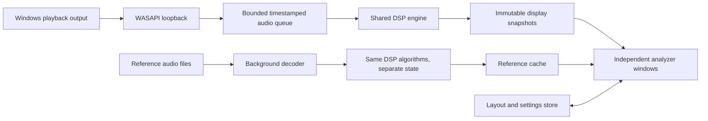

Build a native Windows desktop audio analyzer that starts with one waveform window, lets users add independent analyzer windows, and saves their layouts and settings. The first complete release includes every requested analyzer and imported audio references for both loudness and spectrum.

This plan reflects the confirmed Windows-first scope and research reviewed on November 9, 2026. Recommended initial support is Windows 11 x64, with mono/stereo analysis; macOS and Linux follow through separate capture backends. The project folder was empty when planning began. All performance figures below are proposed acceptance targets, not measured results. Implementation began November 9, 2026; see [docs/PROGRESS.md](docs/PROGRESS.md) for completed work and remaining gates.

The reference products suggest the following design direction. The proposed app should have its own interface and implementation.

| Reference | Documented behavior relevant to this project | Proposed application |
| --- | --- | --- |
| [Voxengo SPAN](https://www.voxengo.com/product/span/) and its [manual](https://www.voxengo.com/files/userguides/VoxengoSPAN_en.pdf/getbyname/Voxengo%20SPAN%20User%20Guide%20en.pdf) | Adjustable FFT size, overlap, display slope, smoothing, secondary spectra, and channel routing. Its default display slope is 4.5 dB/octave. | Expose detailed spectrum controls, with clearly labeled slope and measurement units; include a flat display preset and reference overlays. |
| [Youlean Loudness Meter](https://youlean.co/youlean-loudness-meter/) | Loudness histories, true peak, file analysis, custom presets, and A/B measurement states. | Combine readable live meters with a reference comparison panel and locally analyzed files. |
| [Image-Line Wave Candy](https://www.image-line.com/fl-studio-learning/fl-studio-online-manual/html/plugins/Wave%20Candy.htm) | Scrolling spectral history with resolution, scale, range, weighting, and inspection controls; higher resolution increases processing cost. | Build a calibrated spectrogram with explicit resolution controls. Its manual does not establish a numerical accuracy guarantee or disclose enough detail to reproduce its algorithm. |
| [MiniMeters](https://minimeters.app/) | Waveform channel modes, stereo/correlation views, zero-crossing scope stabilization, and spectrum target curves imported from audio files. | Use compact, readable displays and quick controls. Its target-curve workflow is also directly relevant to reference import. |

MiniMeters also documents [independent windows](https://minimeters.app/help/rearranging-meters/) and [preset controls](https://minimeters.app/help/toolbar/). Those are useful interaction references, but this application's launch and persistence behavior should follow the contract below.

The launch and layout contract is:

1. First launch opens exactly one waveform window and starts monitoring the default Windows playback output. A compact toolbar shows the source, capture status, Add Analyzer, Layouts, and Settings.
2. Add Analyzer opens another top-level window. Multiple instances of the same analyzer are allowed, including two spectrum windows with different FFT settings. Every window can access the shared app controls.
3. Each window has its own settings panel, size, position, display scale, and optional always-on-top state. Settings have useful defaults and an advanced section.
4. Save Layout stores all analyzer types, stable instance IDs, window geometry, monitor identity, DPI-aware coordinates, per-instance settings, reference selections, and source-selection policy. Layouts can be named, duplicated, renamed, deleted, exported, and imported.
5. Subsequent launches still open the waveform by default. The user can explicitly choose a named startup layout or enable Restore Last Session. Saving a layout alone does not change startup behavior.
6. Closing a window removes that analyzer instance from the current workspace. Closing the last window exits by default. A tray/background option can be added later. New launches begin new live measurement sessions; layouts do not silently resume old integrated loudness totals.

Use versioned JSON for layouts, atomic replacement on save, a previous-good backup, and migrations for older schemas. Preserve named layouts separately from crash-recovery state. Restore windows inside an available monitor's work area when the original display is absent; provide Bring All Windows Into View. Missing reference files keep their cached summaries visible and offer relinking when recalculation is needed. A damaged layout must fall back to the waveform without overwriting the damaged file.

The first release has seven analyzer types. Level metering and loudness use separate window types so a compact peak/VU meter does not need the full loudness interface.

| Analyzer | Required behavior | Per-window settings |
| --- | --- | --- |
| Waveform | Scrolling amplitude history, stereo lanes, clipping indication, freeze and inspection. Preserve short peaks when reducing samples to pixels. | History duration, vertical gain, linear/dB view, L/R/M/S selection, lane arrangement, colors, optional RMS envelope. |
| Level meter | Distinct VU, RMS, sample-peak and true-peak modes, numeric maxima, peak hold and clipping indicators. | Meter mode, VU calibration, scale, orientation, peak hold, display release where applicable, colors and thresholds. |
| Loudness | Momentary, short-term and integrated LUFS, LRA, true peak, maxima, elapsed measurement time, history and reference comparison. | Target and tolerance, LU/LUFS scale, graph duration, warnings, reference selection, session start/pause/reset. Standards-based timing stays fixed. |
| Spectrum | Live and averaged traces, peak hold, pointer frequency/note/level, L/R and M/S views, reference and difference curves. | FFT size, window function, overlap, averaging, smoothing, slope, channel mode, frequency/dB limits, comparison gain. |
| Spectrogram | Scrolling time-frequency-energy view, calibrated color scale, freeze, time/frequency/level inspection. | FFT size, window and overlap, history/speed, logarithmic or linear frequency scale, frequency/dB limits, palette and optional piano scale. |
| Stereometer | Vectorscope, correlation from -1 to +1, L/R balance, and mid/side energy readouts. | Orientation, scale, persistence, correlation averaging, display gain and colors. Silence displays an unavailable/neutral state rather than invented correlation. |
| Oscilloscope | Sample-detail waveform, stable triggering, free-run and single-shot modes. | Timebase, trigger channel, threshold and slope, holdoff, amplitude scale, persistence and L/R/M/S selection. |

Keep waveform history and oscilloscope distinct: the former shows musical dynamics across seconds; the latter reveals individual cycles and transients. Proposed initial defaults are a five-second waveform, an 8,192-point spectrum, and a 4,096-point spectrogram with 75% overlap and a Hann window. Treat defaults as prototype decisions to verify, not competitor equivalence claims. Add multiband colors, multiband correlation, and automatic pitch following after the core displays are correct.

Spectrogram accuracy needs an explicit definition: correct frequency/time axes, calibrated levels, known window behavior, and honest resolution limits. At 48 kHz, 4,096 samples span about 85 ms with 11.7 Hz bin spacing; 16,384 span about 341 ms with 2.93 Hz bin spacing. Bin spacing alone is not the ability to resolve two tones. A larger transform improves frequency detail while spreading events over more time. Interpolation and extra display pixels do not recover missing detail. Show transform duration and bin spacing in advanced settings; keep color, display weighting, and zoom separate from raw measurements.

Use **C++20, CMake, and Qt 6 Quick** as the initial stack. Implement controls and window management in QML, with C++ scene-graph items for moving plots. Qt supports custom GPU-rendered geometry and portable shader materials; choose and pin a stable Qt release at implementation time. Keep the DSP library independent of Qt. [Qt scene graph documentation](https://doc.qt.io/qt-6/qtquick-visualcanvas-scenegraph.html)

JUCE is a credible alternative if building DAW plugins becomes a near-term priority, and it already supports GPU-backed Direct2D rendering on Windows. For this standalone application, start with Qt and make the early performance prototype the decision gate; use one UI framework. [JUCE Direct2D overview](https://juce.com/blog/juce-8-feature-overview-direct-2d/)

The proposed data flow is:

Capture uses one event-driven WASAPI shared-mode loopback stream for the selected playback endpoint. Offer Follow Default Output and Pin This Device. Capture the endpoint's native rate and format, convert samples to internal float buffers, and preserve channel metadata. Standard Windows playback can be captured without installing a virtual cable. Exclusive-mode and ASIO paths are not universally covered, and protected content can be unavailable. The source label must describe the captured playback mix. [Microsoft loopback documentation](https://learn.microsoft.com/en-us/windows/win32/coreaudio/loopback-recording), [MiniMeters input guidance](https://minimeters.app/help/selecting-audio-device/)

Initially support mono/stereo endpoints and mono/stereo reference files. If an endpoint exposes more channels, require an explicitly selected channel pair and label the measurement accordingly; do not present that pair as whole-surround-program loudness. Native surround analysis is a later feature. Validate 44.1, 48, 88.2, 96, 176.4 and 192 kHz with performance expectations documented by rate.

Capture must have a state machine for starting, running, no active playback, reconnecting and errors. Handle default-device changes, Bluetooth/USB disconnects, sleep/resume and format changes. Preserve timestamps, sample counters, silence flags and discontinuities. Explicit silence is valid audio; missing data is not. End/mark the affected measurement segment when capture loses samples or changes source, and start a clearly identified new segment after recovery. [Microsoft stream routing](https://learn.microsoft.com/en-us/windows/win32/coreaudio/stream-routing-implementation-considerations), [capture buffer flags](https://learn.microsoft.com/windows/win32/api/audioclient/ne-audioclient-_audclnt_bufferflags)

Idle playback can stop loopback data delivery. Test this separately from capture failure: rolling displays must age to silence or an unavailable state instead of freezing stale readings. Preserve known silence on the measurement timeline and mark uncertain gaps rather than inventing measurement continuity. Verify stop, extended idle, and playback restart explicitly. [NAudio loopback behavior](https://github.com/naudio/NAudio/blob/main/Docs/WasapiLoopbackCapture.md)

The capture thread only receives, timestamps, copies/converts, and releases packets into preallocated storage. It never calls the UI, decodes files, computes FFTs, waits for a consumer, or performs unbounded allocation. A DSP worker consumes all audio needed for measurement and publishes immutable snapshots. UI frames may be skipped; audio samples must not be silently skipped. Queue overflow records a discontinuity rather than blocking capture.

Share computation only when analysis settings match. An analysis key includes source generation, sample rate, channel transform, FFT size, window and hop; reusable transforms can feed separate averaging states. Colors, zoom and labels stay in display state. Each loudness window owns its session/reset state by default, even when common preprocessing is shared. An explicit linked-session option can come later. Closing the last subscriber stops that computation.

Keep histories and queues bounded. Use multiresolution min/max envelopes for the waveform, bounded sample buffers for the scope, cached grid geometry for plots, and a circular texture representation for spectrogram history. Start with bounded texture tiles through public Qt APIs. If profiling requires a partial-upload path using QRhi, isolate it behind a small version-pinned adapter: Qt documents limited compatibility guarantees for that API. [QSG geometry](https://doc.qt.io/qt-6/qsggeometrynode.html), [QRhi compatibility](https://doc.qt.io/qt-6/qrhi.html)

Do not assume seven windows cost the same as seven panels in one window. Qt's rendering behavior changes with multiple windows, and MiniMeters documents frame-rate problems under some driver limiters. Test mixed DPI, mixed refresh rates, dragging, resizing and unfocused windows in the first prototype. [Qt rendering model](https://doc.qt.io/qt-6/qtquick-visualcanvas-scenegraph.html), [MiniMeters Windows issues](https://minimeters.app/help/windows-specifics/)

Hidden/minimized windows stop rendering. Visual-only DSP can sleep if nothing uses it, but a running loudness session continues measuring. Provide separate controls for Hold Display and Pause Measurement so their effects are clear. Offer 60 fps by default and 30 fps Eco mode. Adapt rendering cost before reducing analysis quality, and disclose any user-selected accuracy/resolution tradeoff.

Reference audio is imported and analyzed locally. Support Browse and drag-and-drop in spectrum and loudness windows, backed by one small reference library. Start with WAV, AIFF, FLAC and MP3; choose and pin decoder dependencies after checking format coverage and redistribution requirements. Stream decoded blocks through a cancellable background worker, with progress and a bounded resource budget, so importing a long track does not interrupt monitoring. Imported references do not play automatically.

For loudness references, compute original integrated LUFS, LRA, true peak, maximum momentary/short-term values, duration and a compact time history. Allow whole-file analysis and a selected time range. Use the same algorithms as live measurement with completely separate state. Show the reference's integrated value as an optional target line and show live integrated-minus-reference integrated as a labeled difference. If live short-term loudness is compared with reference integrated loudness, identify both statistics; there is no implied timeline synchronization. Youlean's file-analysis and A/B workflows support this direction. [Youlean file workflow](https://docs.youlean.co/youlean-loudness-meter/getting-started/application), [Youlean comparison workflow](https://youlean.co/youlean-loudness-meter-why-upgrade-to-pro/)

For spectrum references, build a whole-file or selected-range average by averaging linear power before conversion to dB. Store unsloped data. Offer live instantaneous, rolling average and accumulated-session average traces; identify the time coverage of each trace. Overlay the reference and optionally show a live-minus-reference difference curve. Default to original levels, with a clearly displayed manual offset or optional level alignment for comparing tonal shape. Visual gain does not change stored loudness measurements or source audio.

Use the same FFT/window normalization, channel convention, comparison rate and frequency grid for live and reference curves. For a reference with a different sample rate, resample only its spectral comparison path to the live analysis rate with a validated resampler; retain native-rate loudness analysis. Reanalyze incompatible spectral settings from the source file. Restrict comparisons to the shared valid frequency range and mark missing source bandwidth as unavailable. Distinguish tone-amplitude spectrum units from power-density units, with calibrated test expectations. [Welch power-spectrum documentation](https://docs.scipy.org/doc/scipy/reference/generated/scipy.signal.welch.html)

For the default combined stereo curve, average channel powers rather than summing waveforms, which could cancel anti-phase content. Label L, R, Mid and Side explicitly and document the chosen M/S normalization. Reference comparisons default to including all samples in the chosen range; any optional silence exclusion must apply consistently and be visible.

Cache reference results by file content identity, selected range, decoder/algorithm version, sample rate, channel mapping and measurement settings. Retain duration and format metadata. A changed file or incompatible algorithm invalidates its cache. Display-only changes such as palette or slope should not require decoding. A layout references cached analysis and the file location; it does not embed a full audio file by default. Missing files allow viewing compatible cached data but prevent unsupported recalculation.

Loudness correctness is a release gate. Target mono/stereo behavior under [ITU-R BS.1770-5](https://www.itu.int/rec/R-REC-BS.1770-5-202311-I) and the relevant EBU documents. Evaluate [libebur128](https://github.com/jiixyj/libebur128) behind an adapter, then verify the selected version against the required test vectors instead of assuming its advertised support establishes compliance.

Momentary loudness uses 400 ms; short-term uses 3 seconds; integrated loudness uses gated accumulation over the measurement session. Standards mode must retain the specified timing, gating and update behavior, without added attack/release smoothing. Scales, colors, targets and history duration remain configurable. Display unavailable values until sufficient samples exist and mark early LRA as unstable. Keep start/pause/continue/reset semantics explicit. [EBU Tech 3341](https://tech.ebu.ch/docs/tech/tech3341.pdf), [EBU Tech 3342](https://tech.ebu.ch/docs/tech/tech3342.pdf)

Do not cap integrated loudness to the last few minutes to save memory. Use a validated bounded statistical representation for full-session integrated loudness/LRA, with rolling display history stored separately. Validate any histogram approximation against the official test tolerances. True peak requires validated reconstruction filtering; oversampling factor alone does not demonstrate accuracy. VU, RMS, sample peak, true peak and LUFS remain separate measurements. Obtain and verify VU calibration/ballistics requirements before making a standards-compliance claim. [ITU true-peak specification](https://www.itu.int/dms_pubrec/itu-r/rec/bs/R-REC-BS.1770-5-202311-I%21%21PDF-E.pdf), [IEC volume-indicator standard](https://webstore.iec.ch/en/publication/1216)

Use these initial performance targets to make “light, fast and smooth” testable. Select and record an exact reference laptop during the first milestone: approximately a four-core/eight-thread machine with integrated graphics, Windows 11 and a 60 Hz display. Test release builds, 48 kHz stereo, default analysis settings, and about two million total drawable pixels across seven windows.

| Measurement | Initial target |
| --- | --- |
| Waveform-only CPU | At most 50 ms of total process CPU time per elapsed second. |
| Seven default analyzer windows | At most 250 ms of total process CPU time per elapsed second; includes all app threads. |
| Memory | At most 250 MiB private working set at the baseline workload; bounded growth during an eight-hour run. |
| Frame pacing | 60 fps target; 95th-percentile presented-frame interval at most 20 ms and fewer than 1% above 33 ms during steady monitoring. |
| Short-window responsiveness | Waveform/sample-peak end-to-end visual delay target below 75 ms, measured with timestamps. |
| Spectral/loudness response | Report inherent transform/window durations separately from capture, compute and display delay. |
| Startup | Warm start to usable waveform within 1.5 seconds; record cold-start results separately. |
| Continuity | No app-caused capture overruns in an eight-hour baseline run; injected device failures produce visible segment boundaries. |

These are prototype gates to validate and refine before committing to release claims. CPU is expressed as time, not an ambiguous Task Manager percentage: 250 ms/s is one quarter of a logical core's time. Record GPU utilization, power impact, frame pacing and memory as well as CPU. Test 96/192 kHz, large FFTs, many duplicate windows, 4K displays and file imports as separate stress profiles. High-resolution settings are not promised the same budget as defaults.

Implement the work in this order. The early alpha is useful, but the complete v1 requires all seven analyzers and both reference workflows.

| Milestone | Deliverable | Completion gate | Rough effort for one experienced audio/UI developer |
| --- | --- | --- | --- |
| 1. Prove the risky path | Real loopback capture, waveform, basic spectrogram, seven movable test windows and concurrent streaming file decode. Choose dependencies and deployment approach. | Measure multiwindow performance; survive output changes; decide whether the proposed UI/rendering stack meets the budget. | 1-2 weeks |
| 2. Deliver the window workflow | Production waveform, Add Analyzer, per-window settings, layout persistence and startup behavior. | Save/reopen a mixed layout; recover on missing monitors and corrupt configuration; clean-machine app launch. | 2-3 weeks |
| 3. Build spectrum and spectrogram | Calibrated spectral engine, controls, histories, freeze and inspection. | Tone, noise, impulse, close-tone and chirp tests; quantified time/frequency behavior and CPU costs. | 2-3 weeks |
| 4. Complete metering | VU/RMS/peak/true peak, loudness sessions, LRA and histories. | Applicable official loudness/true-peak vectors pass; VU behavior is verified; live/offline boundaries agree. | 2-3 weeks |
| 5. Add reference workflows | Local import, selected-range analysis, caching, loudness comparisons, spectrum overlays and differences. | Reference import remains responsive; matching input produces matching results; cache invalidation and missing files behave correctly. | 2-3 weeks |
| 6. Complete stereo and scope | Vectorscope/correlation, triggered scope, polish settings and shortcuts. | Mono, anti-phase, hard-pan, silence and periodic-signal checks pass. | 1-2 weeks |
| 7. Harden and release | Profiling, device/monitor matrix, long runs, accessibility, installer and dependency notices. | Complete v1 acceptance suite passes on clean machines; publish measured limitations and supported configurations. | 2-4 weeks |

The planning estimate is roughly 12-20 developer-weeks, excluding time waiting on beta feedback or distribution accounts. Re-estimate after milestone 1; this is not a delivery commitment. Once the shared DSP interfaces stabilize, the spectral, metering and window work can proceed in parallel if more developers are available.

Keep implementation boundaries small: platform capture adapters, a headless DSP library, analyzer models, UI/rendering components, reference import/cache, and layout persistence. Provide a headless measurement runner for deterministic test files and a benchmark harness for resource and timing checks. Pin third-party versions and verify an installer on a machine without development tools early, using the supported deployment tools. [Qt Windows deployment](https://doc.qt.io/qt-6/windows-deployment.html)

Accuracy tests should use the official [EBU loudness test set](https://tech.ebu.ch/publications/ebu_loudness_test_set) and [ITU test files](https://www.itu.int/oth/R1102000001), applying each case's published tolerance. Live/offline comparisons must use identical sample boundaries before testing realistic asynchronous capture. Use generated signals for FFT calibration, leakage, anti-phase stereo, transient preservation, triggering, silence and clipping. Check the reference apps with matched settings as secondary behavioral comparisons; they are not the sole numerical oracle.

Application tests cover independent instance settings, resetting one meter without affecting another, layout migration, changed monitor/DPI topology, device unplug/reconnect, output-rate changes, no-device startup, malformed reference files, cancellation, and reference cache invalidation. During performance checks, include background imports, minimized windows, driver frame caps, mixed refresh-rate displays and sleep/resume. Separate expected hardware/OS interruptions from app-caused processing loss in the results.

After v1, add per-application capture, a DAW sender for routing that loopback cannot observe, surround analysis, optional recording/export, advanced spectral techniques, and richer stereo modes. Port capture to macOS and Linux in separate milestones while retaining the DSP and workspace models. Those features do not displace any analyzer, layout saving, or reference import from the complete Windows v1 scope.
